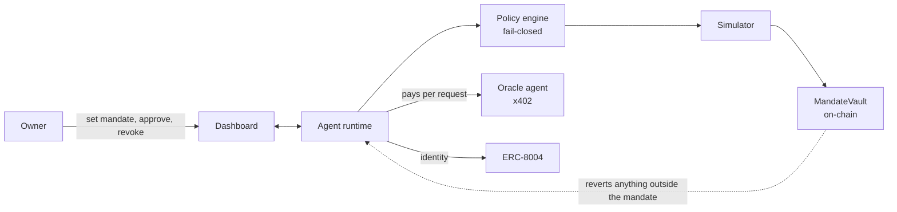

# Mandate

A policy-bound autonomous on-chain wallet agent. An AI agent should hold a mandate, not a key.

The owner grants a scoped, time-bound mandate that a smart contract enforces. The agent operates autonomously inside the mandate, must obtain a human co-signature above it, and is reverted by the chain outside it. The property we defend: a fully compromised agent process, including its prompt, memory, tools and even its private key, cannot move value outside the mandate, because the on-chain enforcement layer does not trust the agent.

Status: a research prototype for the 2026 Shenzhen International FinTech Competition. Testnet only (Base Sepolia, with a local Anvil chain for development). The vault contract is unaudited. Do not use it with real funds. docs/ASSUMPTIONS.md records every default we took.

## Architecture at a glance



Seven defence layers, from context isolation to on-chain enforcement. The off-chain layers make the agent useful and stop attacks early; the on-chain vault is the guarantee. See docs/ARCHITECTURE.md.

## The thesis, measured

A built-in Security Lab replays fourteen documented 2025 to 2026 attack patterns against four defence configurations. The measured result (docs/EVALUATION.md):

| Configuration | Defended, of 14 |
|---|---|
| A: no guards | 0 |
| B: prompt filters only | 4 |
| C: off-chain policy and simulation | 12 |
| D: the full product, with the on-chain vault | 14 |

The two attacks only the vault stops are a compromised agent key and a kill-switch race, and the vault reverts both on-chain with real transaction hashes. The point of the architecture is exactly that gap between 12 and 14.

## 60-second quickstart (local chain, no funding)

```bash
pnpm install
pnpm --filter @mandate/contracts setup
pnpm keys:generate                  # prints the owner, agent and oracle addresses
anvil --chain-id 31337 --block-time 1   # in another terminal
# fund owner and agent from an Anvil account (see docs/RUNBOOK.md), then:
pnpm contracts:deploy:anvil
pnpm identity:anvil
pnpm dev:oracle:anvil
OWNER_APPROVAL_AUTH=dev pnpm dev:api:anvil
pnpm dev:web                        # http://localhost:3000
```

Full instructions, Base Sepolia deployment and the live-LLM setup are in docs/RUNBOOK.md. The demo script is docs/DEMO_SCRIPT.md.

## What is in the repository

| Path | What it is |
|---|---|
| packages/core | The typed intent schema and EIP-712 types, the deterministic policy engine (mandate bounds, sanctions screening, address poisoning, contract risk, provenance, velocity, simulation rules), the injection and decoded-content scanner, the hash-chained audit log and the decision-trace types |
| packages/contracts | MandateVault.sol (per-asset caps, a fixed spending window, target and selector allowlists, an owner co-signature verified on-chain, ERC-1271, a kill switch), mock USDC with EIP-3009, a mock ERC-8004 registry, the Foundry tests, and the deploy, identity and evidence scripts |
| packages/attacks | The fourteen-scenario attack catalog, the four defence configurations, the outcome model and the evaluation report renderer |
| apps/api | The agent runtime: plan-then-execute planner (mock or any OpenAI-compatible model), the quarantine reader, the tool catalogue, the intent pipeline, passkey owner authentication, x402 payments, ERC-8004 identity, the Security Lab runner, and a REST and server-sent-event API |
| apps/oracle | An x402-paid price and risk oracle with an ERC-8004 agent card |
| apps/web | The owner's control tower: Overview, Agent with the live decision trace, Approvals, Mandate editor and kill switch, Security Lab, Audit with verify and tamper demo, Identity |
| docs | The documentation set, below |
| submission | The generated submission package (PDFs, deck, manifest) |

## Documentation

| Document | What it covers |
|---|---|
| docs/ARCHITECTURE.md | Components, trust boundaries, the sequences, the state machine, failure modes, deployment |
| docs/PERMISSION_TIERS.md | The required permission-tier deliverable: tiers, exact parameters, worked examples |
| docs/THREAT_MODEL.md | Assets, actors, STRIDE, attack trees, framework mappings, residual risks |
| docs/SECURITY_SELF_ASSESSMENT.md | The required self-assessment: control matrix, coverage, key management, the known-risk list |
| docs/EVALUATION.md | The measured attack-suite matrix, with methodology and limitations |
| docs/COMPLIANCE.md | How the controls relate to FATF, OFAC, MiCA, the EU AI Act, NIST and more |
| docs/RELATED_WORK.md | Prior art and how Mandate differs |
| docs/adr | The architecture decision records |
| docs/DATA_MODEL.md, docs/API.md, docs/RUNBOOK.md | Persistence, interfaces, and the required deployment instructions |
| docs/EXECUTION_EVIDENCE.md | The required real-transaction evidence table |
| docs/DEMO_SCRIPT.md | The video script and the presentation talk track |
| docs/REFERENCES.md | Every short cite resolved to a source |
| docs/ASSUMPTIONS.md | The defaults we took |

## Honest status and limitations

- The vault is unaudited. It has unit, fuzz and invariant tests and 91 percent line coverage, but no third-party audit. Testnet only.
- The Security Lab attacker is scripted, with a small sample; configurations A to C are modelled, with C using the real policy engine, and D is the real product. See the limitations in docs/EVALUATION.md.
- Slither was not run in the build environment; this is stated in the security self-assessment and is a named next step.
- The guarantee is containment, not correctness: a compromised agent cannot exceed the mandate, but the agent can still be wrong inside it, which is why the caps are small and the owner holds the kill switch.

## Licence

MIT. See LICENSE. Third-party licences are in THIRD_PARTY_NOTICES.md.
