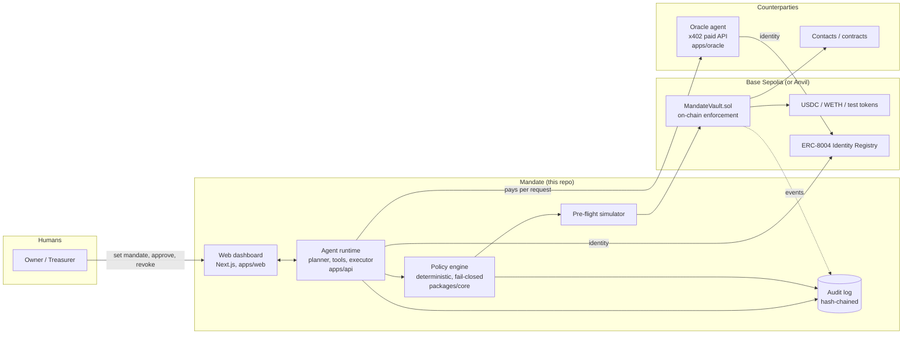
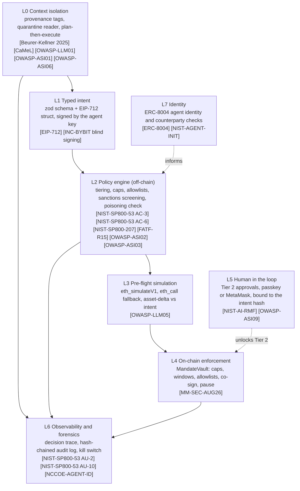
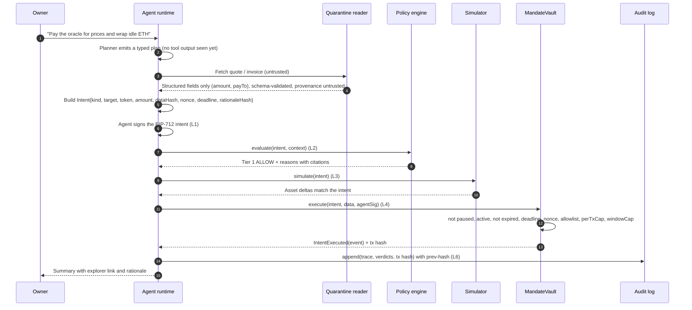
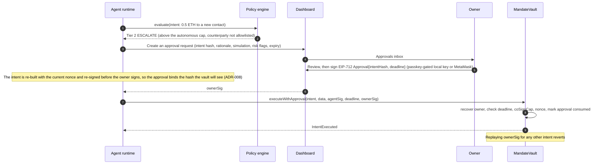
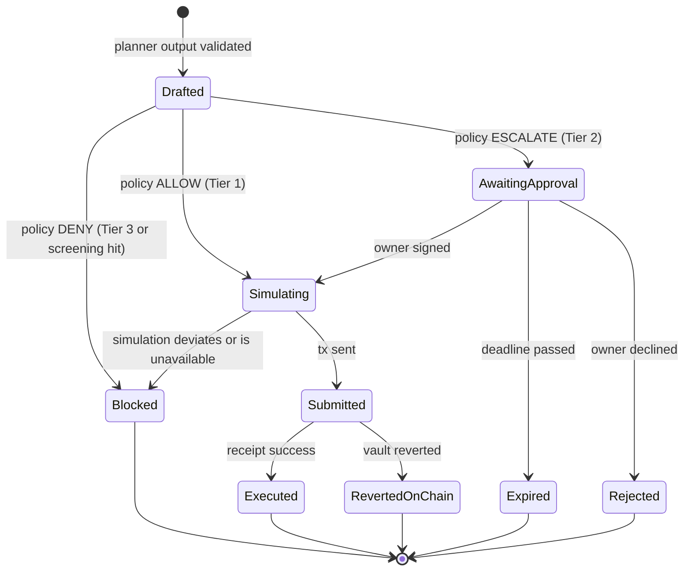
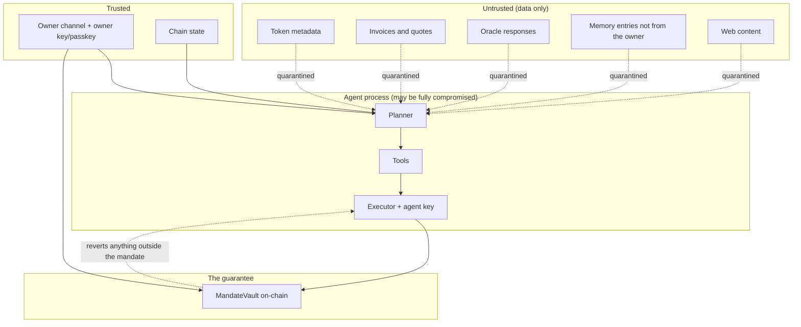
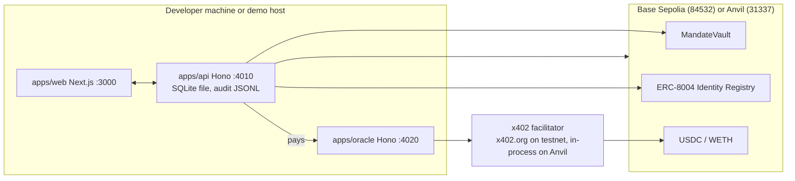

# Architecture

Why read this: it is the map of the system. It shows the components, the trust boundaries between them, how an instruction becomes an on-chain transaction, and what happens when each part fails. Read it before the code.

## 1. The one idea

An AI agent should hold a mandate, not a key. The owner grants a scoped, time-bound mandate that a smart contract enforces. The agent operates autonomously inside the mandate, must obtain a human co-signature above it, and is reverted by the chain outside it. The property we defend is this: a fully compromised agent process, including its prompt, its memory, its tools and even its private key, cannot move value outside the mandate, because the on-chain enforcement layer does not trust the agent.

## 2. System context

The owner talks to the agent only through the dashboard's owner channel. Everything else the agent reads, token metadata, invoices, oracle responses, memory entries, is untrusted data.

## 3. Defence in depth: seven layers

L0 to L3 exist to make the agent useful and to stop attacks early and cheaply. L4 and L5 are the guarantees. The distinction matters: if an attacker defeats L0 to L3, L4 still holds, because the vault re-checks every bound itself and trusts nothing the agent computed. Our evaluation measures exactly this (see docs/EVALUATION.md): with the off-chain layers alone a compromised key still drains the funds, and only the on-chain layer stops it.

## 4. Components and responsibilities

| Layer | Package or app | Responsibility | Trusts |
|---|---|---|---|
| L0 | apps/api (planner, quarantine) | Keep untrusted content out of the planner. Turn it into typed fields with provenance. | The owner channel only |
| L1 | packages/core (intent, eip712) | One typed intent schema, one EIP-712 definition, signed by the agent. | The schema |
| L2 | packages/core (policy) | Deterministic verdict: tier, decision, reasons, citations. Fail closed. | Chain state (the mandate mirror), the sanctions snapshot |
| L3 | apps/api (simulator) | Compare simulated asset deltas with the intent. Fail closed. | The RPC |
| L4 | packages/contracts (MandateVault) | Enforce every bound on-chain. The guarantee. | The owner only |
| L5 | apps/api (auth), apps/web (approvals) | Bind an owner co-signature to one intent hash. | The owner's passkey or wallet |
| L6 | packages/core (audit, trace), apps/web | Hash-chained log, live trace, kill switch. | Nothing; it is append-only and verifiable |
| L7 | apps/api (identity), ERC-8004 registry | Portable on-chain identity, Know Your Agent. | The registry |

## 5. Autonomous execution (Tier 1)

## 6. Escalation (Tier 2)

## 7. Intent lifecycle

Every state transition is an audit-log record. The dashboard's Agent page shows the trace of these transitions live over server-sent events.

## 8. Trust boundaries

The boundary that matters is the one around the vault. The agent process is drawn as a single compromise zone on purpose: we assume all of it can fall. The vault accepts owner transactions and agent transactions, and for agent transactions it re-derives every limit from its own storage.

## 9. Data flow

1. The owner sends a message through the dashboard. It is the only instruction channel.
2. The agent assembles the planner input from trusted sources only: the owner message, the mandate summary read from chain, the address book, memory entries tagged with provenance, and the tool catalogue. Untrusted content is present only as quarantine ids and field names.
3. The planner emits a typed plan: steps naming tools and literal arguments, or references to quarantined values by id. It never receives raw tool output.
4. The executor runs the steps. The only write path is `propose_intent`, which builds a typed intent and runs it through policy, simulation and the vault. There is no raw send tool.
5. Every verdict, transition and receipt is appended to the hash-chained audit log and streamed to the dashboard.

## 10. Failure modes and fail-closed behaviour

| Component unavailable | Behaviour | Where |
|---|---|---|
| Policy engine throws | The intent is denied; the thrown rule is recorded as a deny reason | packages/core, `evaluate` catches per-rule |
| Sanctions list missing or stale | The screening rule denies; nothing transacts | packages/core, `screeningRule` |
| Simulation unavailable or RPC down | The simulation rule denies; nothing is sent | packages/core, `simulationRule`; apps/api `Simulator` returns method "none" |
| LLM endpoint down | The MockPlanner (deterministic) serves the demo scenarios; the live planner returns an empty plan with an explanation on error | apps/api, `MockPlanner`, `LivePlanner` |
| Chain id is not a testnet | The process refuses to start | apps/api `config`, contracts `deploy` and `env` |
| Vault code missing at the configured address | Startup check fails and the process stops | apps/api `runStartupChecks` |
| Owner key missing in local mode | Startup check fails | apps/api `runStartupChecks` |

The rule is uniform: when a layer cannot do its job, the agent does not transact.

## 11. Deployment topology

The three services are independent Node processes. State lives in a SQLite file and an append-only audit JSONL, both under `apps/api/data`. Keys live in `.env`, which is never committed. Nothing requires a database server or a cloud account.

## 12. Where the enforcement actually is

A reader in a hurry should take away one table. For each thing the agent might do, this is the layer that finally stops it when every earlier layer has failed.

| The agent tries to | Finally stopped by | Error |
|---|---|---|
| Send more than the per-transaction cap | L4 the vault | `AbovePerTxCap` |
| Drain the daily window with many small sends | L4 the vault | `AboveWindowCap` |
| Pay a counterparty outside the allowlist | L4 the vault (unless the owner co-signs) | `TargetNotAllowed` |
| Call a contract function outside the allowlist | L4 the vault | `SelectorNotAllowed` |
| Grant an unlimited token approval | L4 the vault | `UnlimitedApproval` |
| Act after the owner revokes or pauses | L4 the vault | `AgentNotActive`, `EnforcedPause` |
| Reuse an owner approval for another intent | L4 the vault | `BadOwnerSignature` |
| Change its own mandate | L4 the vault | `OwnableUnauthorizedAccount` |

See docs/PERMISSION_TIERS.md for the exact parameters and worked examples with transaction hashes, and docs/THREAT_MODEL.md for the attack trees.

Citations resolve in docs/REFERENCES.md.
