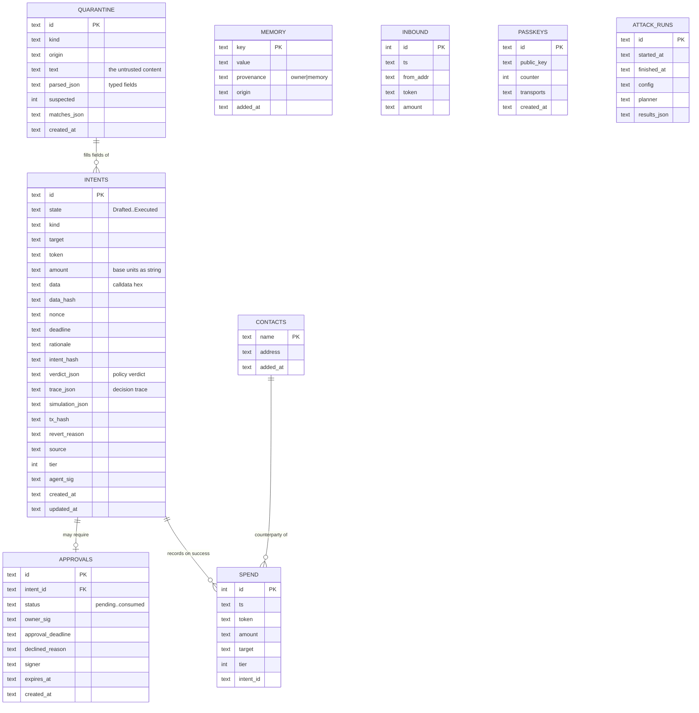
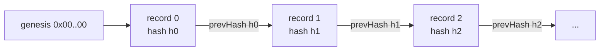

# Data model

Why read this: it describes what the runtime persists and how the audit chain is formed. The schema is in `apps/api/src/db.ts`; this is the map.

## Stores

The runtime keeps two stores:

- A SQLite file (`apps/api/data/mandate-<chainId>.db`), for operational state.
- An append-only JSONL file (`apps/api/data/audit-<chainId>.jsonl`), for the hash-chained audit log.

They are separate on purpose: the audit log is append-only and verifiable, and keeping it out of the mutable database makes tampering obvious.

## Entity relationships



Bigints are stored as decimal strings, because SQLite has no native 256-bit integer and because the audit canonicalisation treats bigints as strings too.

## The audit chain

The audit log is not in the database. Each record is a line of JSON:

```
{ seq, ts, actor, event, payload, prevHash, hash }
```

where `hash = keccak256(prevHash || canonicalJSON({seq, ts, actor, event, payload, prevHash}))` and `canonicalJSON` sorts keys, serialises bigints as decimal strings and drops undefined. The first record's `prevHash` is the genesis hash (32 zero bytes).



`verify()` recomputes the chain from genesis and reports the first record where the sequence, the `prevHash` link, or the recomputed hash does not match. Editing a payload, dropping a record, reordering two records, or appending a forged record all break the chain at or before the tampered record. This is tested in `packages/core/test/audit.test.ts`, and the dashboard's Audit page has a Verify button and a tamper demo that edits a record in a copy and shows verification failing.

## What is hashed, and retention

Every intent transition, every policy verdict with its reasons, every approval signature and decline, every chain receipt, every mandate change, every x402 payment and every attack run is appended. Payloads contain addresses, amounts, intent hashes and transaction hashes. Payloads never contain private keys. For a prototype there is no automatic retention or rotation; a deployment would rotate the JSONL and anchor periodic chain heads on-chain for external verifiability.
