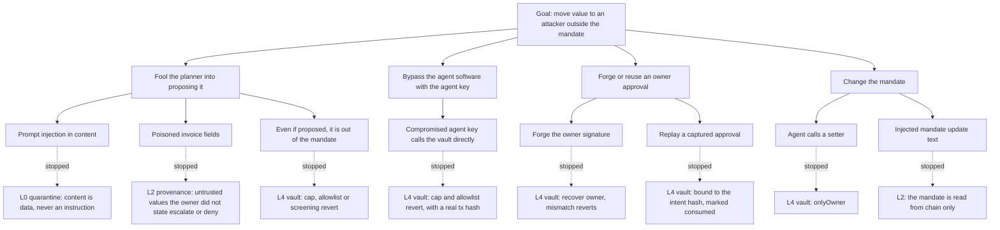
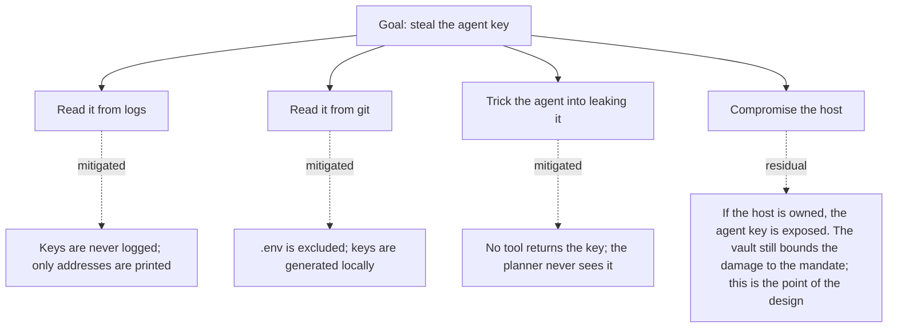
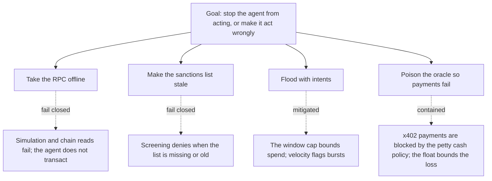

# Threat model

Why read this: it names what we are protecting, who the attackers are, where the trust boundaries lie, and how each layer answers a specific threat. It ends with attack trees and the residual risks we have not closed.

## Assets

| Asset | Why it matters | Where it lives |
|---|---|---|
| The owner's funds | The thing an attacker wants | In the vault; a small float in the agent's account |
| The owner key or passkey | Authorises mandate changes and Tier 2 co-signatures | In the owner's MetaMask, or a passkey (local mode) |
| The agent key | Signs intents and submits vault transactions | In `.env`, testnet only |
| The mandate | The set of bounds the vault enforces | On-chain, in the vault's storage |
| The audit log | The tamper-evident record of what happened | Append-only JSONL, hash-chained |
| Agent and counterparty identities | Who is paying whom | ERC-8004 registry on-chain |

## Actors

| Actor | Trust | Capability we assume |
|---|---|---|
| Owner | Trusted | Sets the mandate, co-signs, revokes. The only source of instructions. |
| Agent process | Untrusted after compromise | May be fully controlled by an attacker: prompt, memory, tools, and the agent key. |
| Counterparty agent (oracle) | Untrusted | Sends invoices and responses that may be hostile. |
| Author of on-chain content | Untrusted | Mints tokens with hostile metadata, dusts look-alike addresses, airdrops NFTs. |
| Network attacker | Untrusted | May tamper with RPC responses; may front-run or censor (testnet, limited relevance). |

The central assumption is the strong one: we design as if the entire agent process can be taken over. That is why the guarantee lives on-chain, where the attacker does not control the code.

## Trust boundaries

See docs/ARCHITECTURE.md section 8 for the diagram. In words:

1. Between untrusted content and the planner. Crossed only by the quarantine reader, which emits typed fields with provenance, never instructions.
2. Between the agent process and the vault. Crossed only by signed intents. The vault re-checks everything.
3. Between the agent and the owner. Crossed only by approval requests going out and EIP-712 signatures coming back, each bound to one intent hash.

## STRIDE per component

| Component | Spoofing | Tampering | Repudiation | Information disclosure | Denial of service | Elevation of privilege |
|---|---|---|---|---|---|---|
| Owner channel | A non-owner message poses as the owner. Mitigated: only the authenticated owner channel is treated as instructions; everything else is quarantined data. | Owner message altered in transit. Mitigated by the transport (HTTPS in production); out of scope on localhost. | Owner denies an action. Mitigated by the hash-chained log and, for Tier 2, the owner's EIP-712 signature. | n/a | Flood the chat. Mitigated by rate limits (operational). | A message tries to grant itself a tier. Mitigated: tier comes only from chain state. |
| Planner | Injected content poses as an instruction. Mitigated: plan-then-execute, the planner never sees raw tool output. | Content tampered to change a plan. Mitigated: untrusted values enter only as quarantined fields with provenance. | n/a | The planner leaks a secret into a plan. Mitigated: no secrets are in the planner input. | A huge payload. Mitigated: length caps on inputs. | Injected "mandate update". Mitigated: the mandate is read from chain only. |
| Policy engine | n/a | A rule is bypassed. Mitigated: deterministic, pure, every rule runs; a throwing rule denies. | Verdicts are logged with reasons and citations. | n/a | A rule hangs. Mitigated: the rules are pure and bounded. | n/a |
| Simulator | A forged simulation result. Mitigated: the simulator talks to the RPC directly, not through the agent. | n/a | n/a | n/a | RPC down. Mitigated: fail closed, the intent is denied. | n/a |
| Vault | An attacker submits as the agent. Mitigated: the signature must recover to `msg.sender`, and `msg.sender` must be the agent. | Intent fields altered after signing. Mitigated: the EIP-712 hash changes, the signature fails. | Every execution emits `IntentExecuted`; reverts are evidence. | n/a | Reentrancy. Mitigated: `nonReentrant`, effects before interactions. | The agent calls an owner function. Mitigated: `onlyOwner`. |
| Audit log | n/a | A record is edited or dropped. Detected: each hash covers the previous hash and the record; `verify` recomputes the chain. | The log is the non-repudiation record. | The log may contain addresses and amounts, not keys. | The file grows. Mitigated: append-only, rotated operationally. | n/a |
| Approvals | A forged owner signature. Mitigated: the vault recovers `owner()` and checks it. | The approved deadline is changed. Mitigated: the deadline is in the signed struct. | The owner signs, which is the record. | n/a | n/a | An approval reused for another intent. Mitigated: bound to the intent hash, marked consumed. |

## Attack tree: move value outside the mandate

Every leaf is stopped by at least one layer, and every leaf that reaches the chain is stopped by the vault. This is the claim the Security Lab measures: with the off-chain layers removed, the compromised-key and approval paths succeed, and only the vault closes them (docs/EVALUATION.md).

## Attack tree: exfiltrate the agent key

Stealing the agent key is not game over. It is exactly the scenario the vault is built for: a key-holding attacker can still only act inside the mandate, and the owner's kill switch ends even that.

## Attack tree: deny service

Denial of service degrades the agent to doing nothing, which is the safe failure. It cannot be turned into unsafe action.

## Mapping to the frameworks

### OWASP Top 10 for LLM Applications 2025

| Risk | How it applies | Control |
|---|---|---|
| LLM01 Prompt Injection | Injected instructions in content | L0 quarantine, plan-then-execute; L2 provenance and decoded-content rules |
| LLM02 Sensitive Information Disclosure | Leaking keys or owner data | No secrets in the planner input; keys never logged |
| LLM04 Data and Model Poisoning | Poisoned memory or history | Provenance tags on memory; the planner is told which entries are the owner's |
| LLM05 Improper Output Handling | Acting on unvalidated output | L3 simulation compares asset deltas with the intent |
| LLM06 Excessive Agency | The agent does more than intended | Tiers; the only write path is a typed intent; the vault bounds everything |
| LLM10 Unbounded Consumption | Runaway spend | Per-transaction and per-window caps, on-chain |

### OWASP Top 10 for Agentic Applications 2026

| Risk | How it applies | Control |
|---|---|---|
| ASI01 Agent Goal Hijack | Injected goals | L0, L2; measured in the Security Lab |
| ASI02 Tool Misuse and Exploitation | Abusing a tool to move funds | No raw send tool; tools declare tier and side effects; the vault enforces |
| ASI03 Identity and Privilege Abuse | Claiming a higher tier | Tier comes from chain state; `onlyOwner` on setters |
| ASI06 Memory and Context Poisoning | Planted preferences | Provenance on memory entries |
| ASI07 Insecure Inter-Agent Communication | Hostile counterparty | x402 petty cash policy; Know Your Agent against ERC-8004 |
| ASI09 Human-Agent Trust Exploitation | "The owner approved this" | Approvals exist only as EIP-712 signatures the vault verifies |
| ASI10 Rogue Agents | A compromised agent | The vault; the kill switch |

### MITRE ATLAS

| Technique | How it applies | Control |
|---|---|---|
| AML.T0051 LLM Prompt Injection (.000 Direct, .001 Indirect) | Direct and indirect injection scenarios | L0, L2 |
| AML.T0054 LLM Jailbreak | Attempts to lift the agent's limits | Limits are on-chain, not in the prompt |
| AML.T0048 External Harms (financial) | The goal of every scenario | The vault |

Technique identifiers are to be confirmed on the ATLAS site before the final submission; see the note in docs/REFERENCES.md.

## Residual risks

These are risks we have not closed. They are stated plainly in docs/SECURITY_SELF_ASSESSMENT.md with a severity and a status.

1. The vault is unaudited. It has tests, fuzzing and invariants, but no third-party audit. Testnet only.
2. In local owner mode the owner key is held by the server behind a passkey prompt. A host compromise exposes it. MetaMask mode removes this.
3. The agent key lives in `.env` on the host. A host compromise exposes it; the vault bounds the damage, which is the design, but the float in the agent's account is at risk.
4. The sanctions snapshot is only as fresh as the last refresh. We fail closed when it is stale, which trades availability for safety.
5. The LLM is non-deterministic. We mitigate with the MockPlanner for the demo and structured outputs for the live planner, but a model can still produce a surprising plan; the vault is the backstop.
6. RPC trust: a tampered RPC could, in principle, feed wrong state. We fail closed on unavailability; a lying-but-available RPC is a residual risk on a hostile network.
7. The Security Lab attacker is scripted, with a small sample. See the limitations in docs/EVALUATION.md.

Citations resolve in docs/REFERENCES.md.
